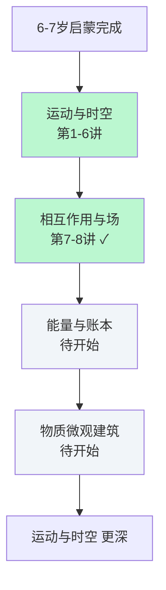

# 小星星物理学螺旋地图

> 最后更新：2026-10-12  
> 当前阶段：第一阶段（7–8岁）· 直觉量化与追问本质  
> 已完成：8 / 26 讲

## 四根主线当前深度

| 主线               | 已回旋次数 | 当前最深讲次              | 状态     |
|--------------------|------------|---------------------------|----------|
| 运动与时空         | 6          | 第6讲 如果地球突然停止转动 | 🟢 进行中 |
| 相互作用与场       | 2          | 第8讲 正负电荷的喜欢与讨厌 | 🟢 进行中 |
| 能量与账本         | 0          | —                         | ⚪ 未开始 |
| 物质的微观建筑     | 0          | —                         | ⚪ 未开始 |

## 第一阶段完整进度（26讲）

### 一、运动与时空（1–6）

- [x] 01 坐在高铁上，为什么树在后退？
- [x] 02 向上抛球，为什么它总落回手里？
- [x] 03 公交车急刹车时人为什么往前倾？
- [x] 04 转圈时为什么觉得自己没动、世界在转？
- [x] 05 火箭为什么能飞出地球？
- [x] 06 如果地球突然停止转动，会发生什么？

### 二、相互作用与场（7–13）

- [x] 07 摩擦起电的魔术：为什么梳子能吸纸屑？
- [x] 08 正负电荷的“喜欢”与“讨厌”
- [ ] 09 为什么冬天脱毛衣会“噼啪”响？
- [ ] 10 磁铁的神秘力线
- [ ] 11 电和磁是亲戚吗？
- [ ] 12 为什么感觉不到人和人之间的引力？
- [ ] 13 场是什么？

### 三、能量与账本 + 物质微观建筑（14–20）

- [ ] 14 热不是一种“热物质”
- [ ] 15 分子的疯狂舞蹈：为什么墨水会在水里散开？
- [ ] 16 温度是什么？——平均激烈的程度
- [ ] 17 绝对零度：原子彻底“冷静”的极限
- [ ] 18 为什么冰会浮在水上？
- [ ] 19 蒸发与冷凝
- [ ] 20 摩擦生热

### 四、流体的力量（21–26）

- [ ] 21 为什么大船能浮在水面上？
- [ ] 22 压强是什么？
- [ ] 23 潜水员为什么要慢慢上来？
- [ ] 24 飞机翅膀为什么能飞？
- [ ] 25 连通器与喷泉
- [ ] 26 综合回旋：用四根主线解释一次完整的飞行

---

## 螺旋示意（Mermaid）

> 每完成一讲，回来把对应的 `[ ]` 改成 `[x]`，并更新上方的「已回旋次数」。  
> 这就是我们真正的学习地图——看着自己在螺旋上一次比一次走得更深。
